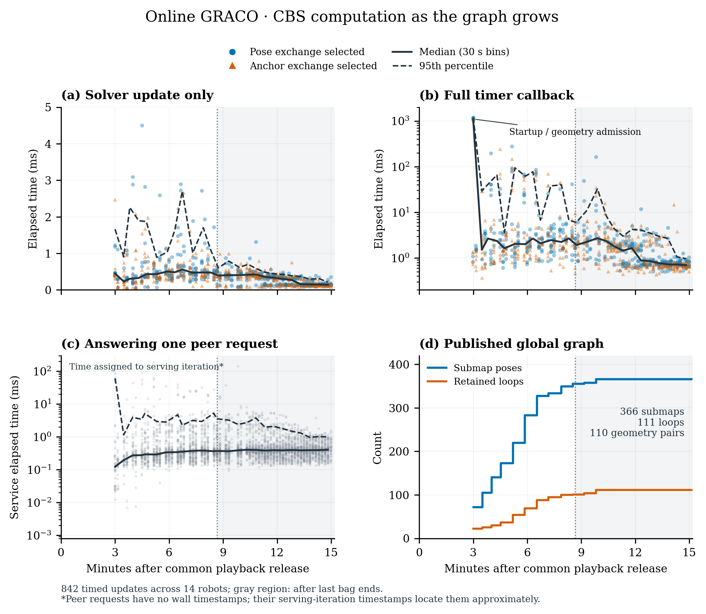

# Online GRACO all 14

All 14 robots formed one aligned component. Fresh simultaneous 1× replay of all 14 GRACO robots on workstation 148: 366 circle submaps, 111 verified loops, 111 PCM-retained loops, 1 final components. This run consumes growing observations and exchanges peer DDS messages during playback.

Immediate freeze → maturation: circles 358 → 366, loops 4 → 111, components 11 → 1, largest component 4 → 14, empty layers 197 → 74, evidence fraction 0.347 → 0.915, communication MB 128 → 547. Fresh independent 1x odometry replays; same calibration and method thresholds, publication policy changed. Lower traffic alone is not a mapping-quality benefit.

Joint ATE by connected component: aerial01 (14 robots): 0.933 m. Evo 1.36.5; corrected IMU-reference GRACO GT; 50 ms association; one rigid alignment per component; no scale fitting.

First shared alignment after playback release: 430.5 s; available before the first bag ended: False. First all-14 alignment: 430.5 s. Final publication: 909.2 s; post-playback settling: 389.1 s. 13 growing graph revisions; final per-robot iteration counts: 60–62. Iterations target 10 s, randomly selecting pose or anchor exchange each iteration; admission/overruns can take longer.

Circle centers, IDs and creation anchors stay fixed while their unpublished geometry accumulates. Normal publication requires at least 30 seconds of age, no more than 5% growth in both native point IDs and occupied cells over 30 seconds, supported terrain and at least the existing five-feature retrieval minimum. Publication follows permanent ID order. A 120-second deadline bounds head-of-line waiting; end-of-stream tails are explicitly labelled. Publication reasons: {'deadline': 129, 'stable': 188, 'end_of_stream': 49}. Geometry becomes immutable at publication; later observations do not revise it. The input is a growing union of live native 80 m area exports, not every original scan. Published evidence contains 91.5% of final retained point IDs. The 99% footprint coverage target is distinct from frozen-evidence coverage.

Retrieval diagnosis: 74 of 366 circles lacked terrain support; 74 had no layered ORB features. The preserved legacy multilayer configuration has no full-height retrieval fallback. 120 candidates reached 3D verification, with 111 accepted. Matching, terrain, verification, PCM and registration thresholds are unchanged. This trial changes geometry publication only.

Measured application traffic: 546.77 MB total (39.05 MB per robot): retrieval/verification 524.40, PCM 1.21, registration geometry 17.75, CBS 3.41 MB. Actual remote serialized application traffic; peer retrieval fan-out, PCM, geometry exchange, CBS requests and responses. Excludes DDS/IP/discovery, local sensor transport, visualization and downloads. These bytes do not establish a matched win against three-robot baseline runs. Low traffic with few loops and disconnected robots is not an equivalent mapping outcome to the successful staged run.

Measured end-to-end wall time 913.2 s; peak simultaneous process-tree RSS 42.34 GiB. Shared pages may be counted more than once. Whole-device GPU peak: 4135.0 MiB. No host resource quotas. Native callbacks use four threads, numerical libraries one thread per process.

Every published payload was checked against an independent reconstruction of its seal-time observation prefix. Descriptor/evidence hashes, immutable graph prefixes, both-endpoint loop receipt before graph admission, finite chronological odometry, successful-update gaps, final registration support and published loop-transform consistency passed. No frozen graph replay or centralized solve was used to produce this result.

PLY files contain every unique retained native representative once per robot, re-posed by the nearest optimized circle. Uncovered points are retained and flagged. Components are exported separately; native IMU gravity sets their display orientation. GT is used only for trajectory evaluation. Per-robot live Rerun recordings and all bulk inputs remain on 148.

| Robot | Circles | Raw ATE (m) | CBS individual ATE (m) | Largest update gap (s) | Component |
| --- | --- | --- | --- | --- | --- |
| aerial01 | 31 | 0.180 | 0.300 | 0.384 | aerial01 |
| aerial02 | 15 | 0.061 | 0.061 | 0.189 | aerial01 |
| aerial03 | 22 | 0.065 | 0.224 | 0.352 | aerial01 |
| aerial04 | 22 | 0.115 | 0.115 | 0.160 | aerial01 |
| aerial05 | 30 | 0.173 | 0.204 | 0.300 | aerial01 |
| aerial06 | 19 | 0.064 | 0.065 | 0.403 | aerial01 |
| aerial07 | 24 | 0.075 | 0.074 | 0.376 | aerial01 |
| aerial08 | 21 | 0.123 | 0.245 | 0.128 | aerial01 |
| ground01 | 23 | 0.297 | 0.292 | 0.472 | aerial01 |
| ground02 | 30 | 0.649 | 0.679 | 0.328 | aerial01 |
| ground03 | 24 | 0.598 | 0.584 | 0.344 | aerial01 |
| ground04 | 30 | 0.515 | 0.494 | 0.392 | aerial01 |
| ground05 | 46 | 0.477 | 0.462 | 0.312 | aerial01 |
| ground06 | 29 | 0.443 | 0.446 | 0.344 | aerial01 |

All 14 shared a common frame before the last bag ended. The final 0.933 m ATE includes 389 seconds of post-playback settling. Of 111 retained loop constraints, 110 live GPU registration pairs were admitted and passed final support checks; G02/26–G04/4 failed the unchanged initial overlap gate, so only its pose constraint was kept. Tests: 38 passed, three native-gated skips; all 14 Rerun recordings validated.

See [implementation and results](IMPLEMENTATION.md).

## CBS computation and graph growth

The 842 measured nonterminal solver updates took 0.351 ms median, 1.003 ms at the 95th percentile and 4.499 ms maximum. Full callbacks took 1.629 / 32.230 / 1188.685 ms respectively. The 3,930 logged peer-service requests took 0.379 / 2.385 / 190.248 ms. The final local optimizers had at most 61 variables. No end-to-end ten-second publication guarantee is inferred from these measurements. Terminal callback and final geometry-validation time is not logged in the timer CSV.

[Timing plots, measurement scope and data](cbs-timing/index.html)

