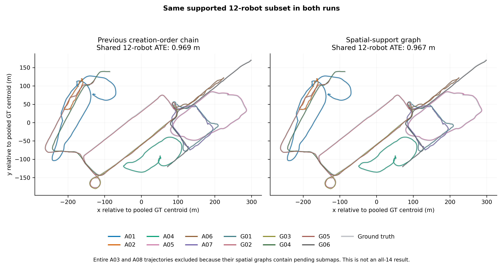
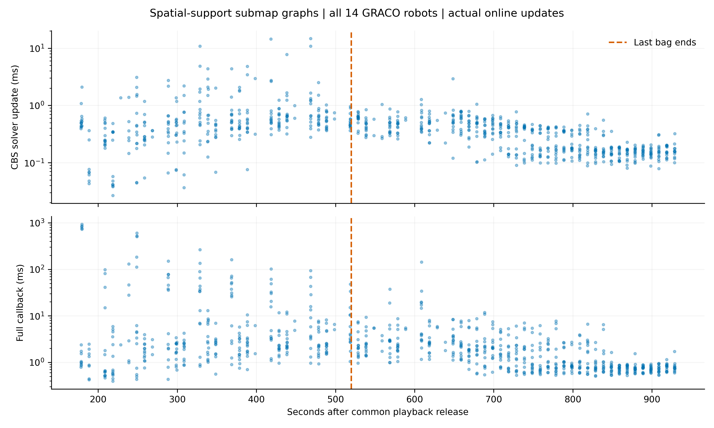

# GRACO 14-robot spatial graph: incomplete alignment

3 submaps remain pending. Their geometry has no accepted local path to the reference submap. The present one-anchor-per-robot CBS interface cannot activate a fragment through an inter-robot loop alone. No artificial links were added; no all-14 joint ATE or global PLY is claimed. Subset accuracy excludes entire trajectories for aerial03, aerial08 in both methods. Evo 1.36.5 uses corrected GRACO IMU-reference ground truth, 50 ms association, one shared rigid alignment, and no scale fit.

| Metric | Prior chain | Spatial support |
| --- | ---: | ---: |
| Published submaps | 366 | 355 |
| PCM-retained loops | 111 | 113 |
| Pending submaps | 0 | 3 |
| Total application communication (MB) | 546.767 | 526.967 |
| PCM (MB) | 1.206 | 1.731 |
| CBS (MB) | 3.412 | 4.837 |
| Registration geometry (MB) | 17.752 | 19.195 |
| Retrieval / verification (MB) | 524.398 | 501.204 |
| Root-frame groups | 1 | 1 |
| Local map factors | 352 | 439 |
| CBS solver median (ms) | 0.351 | 0.367 |
| CBS solver p95 (ms) | 1.003 | 1.363 |
| CBS solver maximum (ms) | 4.499 | 14.744 |
| Full callback p95 (ms) | 32.230 | 37.464 |
| Wall time (s) | 913.152 | 943.340 |
| Peak simultaneous RSS (GiB) | 42.337 | 42.204 |
| Joint ATE on the same 12-robot supported subset (m) | 0.969 | 0.967 |

## Validation and comparison scope

All 14 native replays completed without divergence. Maximum speed: 5.428 m/s; longest successful-LiDAR-update gap: 0.232 s. All 14 Rerun recordings passed verification. The independent audit checked sealed geometry membership, immutable payloads, causal availability and native calibration. All robot reference frames connected; three local submaps did not. No chronological fallback edges were inserted.

These are fresh independent online replays; scheduling, odometry, geometry and retrieval opportunities can differ. Communication excludes DDS/IP/discovery, sensors, visualization and report downloads. The spatial result is incomplete, so costs are not comparisons at an equivalent final outcome.

## Individual errors

| Robot | Raw individual ATE (m) | Spatial corrected individual ATE (m) |
| --- | ---: | ---: |
| aerial01 | 0.181 | 0.225 |
| aerial02 | 0.059 | 0.093 |
| aerial03 | 0.061 | Not evaluated: pending submaps |
| aerial04 | 0.108 | 0.134 |
| aerial05 | 0.186 | 0.185 |
| aerial06 | 0.060 | 0.076 |
| aerial07 | 0.076 | 0.117 |
| aerial08 | 0.125 | Not evaluated: pending submaps |
| ground01 | 0.296 | 0.303 |
| ground02 | 0.648 | 0.659 |
| ground03 | 0.596 | 0.555 |
| ground04 | 0.515 | 0.494 |
| ground05 | 0.476 | 0.464 |
| ground06 | 0.444 | 0.462 |

Individual errors each use a separate rigid fit. They do not measure inter-robot alignment.
